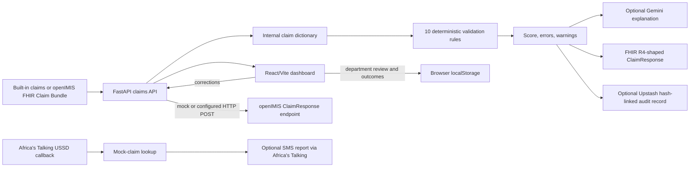

# Hakiki Architecture and Change Record

**Evidence snapshot:** repository tree and Git history inspected on 2026-11-01. Paths and line numbers below refer to this repository as it was inspected. “UNKNOWN” means the repository does not establish the fact. Features are classified using exactly `IMPLEMENTED`, `PARTIAL`, `MOCKED`, or `PLANNED`.

## 1. Project summary

Hakiki (formerly **ClaimSense**) is a claims preparation and review prototype for Kenyan healthcare providers. Its main job is to check a draft SHA-related claim before submission, show rule failures and a readiness score, let staff correct fields, and create a FHIR-shaped response. It is presented as a companion to existing hospital information systems and openIMIS, not as a replacement HMIS. Evidence: `README.md:L1-L15`, `L87-L114`, `L238-L261`; rename commits `370b1da` and `a9bf917`.

The original project was built for openIMIS Hackathon Track 3 (Claims Management). Its current local tree includes deterministic validation, optional Gemini explanations, an openIMIS FHIR client, a hash-linked audit log, a USSD/SMS claim-status flow, departmental checklists, and manually entered outcome feedback. Several of those integrations use mock data or browser-only state. Evidence: `README.md:L87-L114`, `L238-L261`; `backend/main.py:L83-L98`, `L173-L247`, `L255-L383`; `backend/ussd/handler.py:L18-L28`, `L43-L154`; `frontend/src/components/DeptGuideTab.jsx:L22-L66`; `frontend/src/components/OutcomeFeedbackTab.jsx:L31-L86`.

Names in the repository are inconsistent: the product/readme and frontend package are Hakiki, while Python modules, FastAPI metadata, prompts, older docs, URLs, and some FHIR extension namespaces still say ClaimSense/claimsense. Evidence: `backend/main.py:L1-L11`, `L53-L57`; `backend/llm/explainer.py:L68-L71`; `backend/fhir/builder.py:L84-L98`; `frontend/package.json:L1-L4`; `frontend/src/api/client.js:L1-L1`.

## 2. Tech stack, versions, and repository tree

### Stack

| Area | What the repository specifies | Evidence |
|---|---|---|
| Backend | Python, FastAPI `0.139.0`, Uvicorn `0.51.0`, Pydantic `2.13.4`; README says Python 3.10+. | `backend/requirements.txt:L1-L40`; `README.md:L154-L212` |
| Frontend | JavaScript/JSX, React and React DOM `18.3.1`, Vite `8.1.3`, Tailwind `3.4.4`, PostCSS, ESLint. | `frontend/package.json:L1-L32`; `frontend/vite.config.js:L1-L10`; `frontend/tailwind.config.js` |
| HTTP/integrations | `httpx` for openIMIS and Upstash REST; Google Gen AI SDK for Gemini; Africa’s Talking SDK for SMS; `requests` for the monitor. | `backend/requirements.txt:L1-L40`; `backend/fhir/client.py:L6-L8`; `backend/audit/chain.py:L20-L44`; `backend/llm/explainer.py:L10-L14`; `backend/ussd/sms_sender.py:L8-L10`; `monitor.py:L10-L12` |
| Data stores | No application SQL database is configured. Claims and corrections are in Python memory; department/outcome records use browser `localStorage`; optional audit records use Upstash Redis REST. | `backend/main.py:L68-L80`; `backend/audit/chain.py:L8-L11`, `L22-L25`; `frontend/src/components/DeptGuideTab.jsx:L14-L43`; `frontend/src/components/OutcomeFeedbackTab.jsx:L16-L28`, `L71-L85` |
| Hosting | `backend/vercel.json` configures a Vercel Python function and catch-all route. A GitHub Actions workflow schedules uptime checks. No frontend deployment config or deployed project state is proven by this repository. | `backend/vercel.json`; `.github/workflows/uptime-check.yml:L1-L28` |
| External services | openIMIS FHIR API, Google Gemini API, Upstash Redis REST, Africa’s Talking SMS/USSD, Vercel, Groq and Discord for uptime alerts, Google Fonts. Endpoint/account regions are not configured in source. | `backend/fhir/client.py:L13-L68`; `backend/llm/explainer.py:L87-L114`; `backend/audit/chain.py:L35-L44`; `backend/ussd/sms_sender.py:L15-L26`, `L63-L77`; `monitor.py:L44-L84`; `frontend/index.html:L12-L15` |

### Repository tree

```text
claimsense/
├── .github/workflows/uptime-check.yml   scheduled uptime check and alert job
├── backend/
│   ├── main.py                         FastAPI app, API routes, in-memory correction state
│   ├── config.py                       environment-variable loader and mock/live switches
│   ├── requirements.txt                pinned Python dependencies
│   ├── vercel.json                     Vercel Python function routing
│   ├── validation/                     deterministic rule definitions and score engine
│   ├── data/mock_claims.py              built-in demo claim records
│   ├── fhir/                            openIMIS FHIR client and ClaimResponse builder
│   ├── llm/                             Gemini explainer and department prompt context
│   ├── audit/                           Upstash-backed hash-linked validation history
│   ├── ussd/                            Africa’s Talking callback and SMS sender
│   ├── tests/test_validation.py          validation unit tests
│   └── test_upstash.py                  one-off external Redis connectivity script
├── frontend/
│   ├── package.json / package-lock.json  React/Vite dependencies and scripts
│   └── src/
│       ├── App.jsx                      landing/dashboard composition and add-claim flow
│       ├── api/client.js                 browser-to-FastAPI request wrapper
│       ├── hooks/                        queue, validation, and audit state
│       ├── components/                   queue, validation, score, audit, department, outcome UI
│       ├── data/departmentGuides.js      static departmental checklist definitions
│       └── constants/status.js           score bands, colors, and editable fields
├── monitor.py                           uptime check, optional Groq diagnosis, Discord alert
├── README.md                            product and local setup description (some stale claims)
├── PILOT_ROADMAP.md                     local pilot notes; not present in HEAD at inspection
├── ClaimSense_Presentation.odp           hackathon presentation deck
└── uptime_state.json                    monitor state file
```

Tree evidence: `rg --files`; the component purposes are shown by `backend/main.py`, `backend/validation/engine.py`, `backend/fhir/client.py`, `backend/fhir/builder.py`, `backend/llm/explainer.py`, `backend/audit/chain.py`, `backend/ussd/handler.py`, `frontend/src/App.jsx`, `frontend/src/api/client.js`, `frontend/src/hooks/`, and the named component files.

## 3. Architecture and data flow



The backend imports claims, validation, FHIR, LLM, and audit modules, then exposes routes through FastAPI. The frontend uses a JSON `fetch` wrapper with a default loopback backend origin. Evidence: `backend/main.py:L23-L32`, `L53-L70`; `frontend/src/api/client.js:L1-L34`.

The main path is `full_pipeline(claim)`: `validate`, `explain_errors`, `build_claim_response`, `record_validation`, then return the result. Claim data comes from `MOCK_CLAIMS` when no openIMIS token exists; otherwise the list route tries a FHIR Claim search and falls back to mock data on errors or an empty result. Evidence: `backend/main.py:L83-L98`, `L173-L215`; `backend/config.py:L7-L19`.

This is not a verified production SHA/DHA architecture. The repository contains no SHA HIE client or endpoint, no DHIS/registry connector, and no approved facility HMIS adapter. openIMIS is the only claims-system connector present. Evidence: `backend/fhir/client.py:L13-L68`; `backend/main.py` route definitions `L173-L383`; `backend/requirements.txt:L1-L40`.

## 4. Pipeline stages

| Stage | Input → output | Code and behavior |
|---|---|---|
| Prepare | Existing internal claim dictionary or FHIR Claim entry → flat internal dictionary. | `get_claims_parsed` and `_fhir_claim_to_internal` map selected Claim fields. Manual Add Claim currently calls a missing `api.createClaim` function and falls back to frontend-only state. `backend/fhir/client.py:L35-L45`, `L71-L147`; `frontend/src/hooks/useClaims.js:L62-L82`; `frontend/src/api/client.js:L15-L34`; `backend/main.py:L173-L252` (no `POST /claims`). |
| Check | Claim dictionary → per-rule pass/fail results, errors, warnings, score and status. | `validate` executes `ALL_RULES`; error failures deduct 20 and warnings 10. `backend/validation/engine.py:L20-L70`; `backend/validation/rules.py:L345-L356`. |
| Understand | Failed rule objects and selected claim context → explanation map. | Optional Gemini request; built-in suggestions are used if disabled or on errors. `backend/llm/explainer.py:L38-L114`. |
| Correct | Claim ID plus edited fields, or raw corrected claim → corrected in-memory claim and new validation. | `/correct` stores to process memory; `/validate` accepts a raw claim without saving. The frontend can simulate if the API is unavailable. `backend/main.py:L271-L298`; `frontend/src/hooks/useClaimValidation.js:L97-L143`. |
| Submit | Claim with zero error-severity failures → FHIR ClaimResponse JSON; either a mock success or HTTP POST. | Warnings do not block. The live mode posts a `ClaimResponse`, not a FHIR `Claim`. `backend/main.py:L301-L345`; `backend/fhir/builder.py:L13-L99`; `backend/fhir/client.py:L47-L57`. |
| Review | Claim ID and department → checklist progress, evidence references, typed reviewer sign-off. | Browser-only checklist state; edits revoke previous sign-off. `frontend/src/components/DeptGuideTab.jsx:L14-L66`, `L119-L195`. |
| Learn | Staff-selected outcome and reason → local browser summaries. | Manual records only; no payer/remittance feed. `frontend/src/components/OutcomeFeedbackTab.jsx:L4-L28`, `L31-L86`. |
| Patient channel | USSD form input and caller phone → lookup on mock claims and optional SMS report. | This is claim-status viewing/reporting, not a patient confirmation or dispute workflow. `backend/main.py:L352-L383`; `backend/ussd/handler.py:L43-L154`. |

## 5. Validation rules and scoring

`README.md` and older route comments refer to seven rules, but the active backend `ALL_RULES` list contains ten rule functions. IDs and behavior below come from the code, not the README. Each failed `error` rule deducts 20 points; each failed `warning` deducts 10; score floors at zero. Status bands are 85–100 Ready for Submission, 60–84 Needs Review, and 0–59 High Risk. Evidence: `backend/validation/engine.py:L20-L45`, `L48-L70`; `backend/validation/rules.py:L345-L356`.

| Rule ID | What it checks | Severity / score impact | Actual condition and evidence |
|---|---|---|---|
| `MISSING_FIELDS` | `patient_id`, `facility_code`, `visit_date`, and `diagnosis_code` are non-empty. | Error / −20 | `rule_required_fields`; `backend/validation/rules.py:L45-L69`. |
| `INVALID_ICD10` | Diagnosis code matches a format regex: uppercase letter, two digits, optional dot and 1–4 alphanumeric characters. | Error / −20 | This checks shape only; it does not query a full ICD-10 code set. `backend/validation/rules.py:L72-L101`. |
| `VISIT_DATE` | Date parses as `YYYY-MM-DD` and is not after the server’s current date. | Error / −20 | Empty date is left to `MISSING_FIELDS`. `backend/validation/rules.py:L104-L137`. |
| `EMPTY_ITEMS` | At least one item exists and every item has a service code; quantity must be a positive number. | Missing items/code: error / −20. Invalid quantity: warning / −10. | The code checks that a service code is non-empty, not that it is in a SHA service-code registry. `backend/validation/rules.py:L140-L182`. |
| `AMOUNT_MISMATCH` | Claimed total is within 5% of sum of `unit_price × quantity`. | Warning / −10 | Failure is only when relative difference is greater than 5%; empty or zero-value items pass this rule. `backend/validation/rules.py:L185-L219`. |
| `COVERAGE_EXPIRED` | Visit date is on/before `coverage_end_date`. | Error / −20 | If either date is absent or malformed, this rule passes; it does not call the `Coverage` endpoint. `backend/validation/rules.py:L222-L250`; `backend/fhir/client.py:L59-L68`. |
| `AMOUNT_HIGH` | Claimed amount over a hard-coded threshold. | Warning / −10 | `150,000` for a code beginning with `O` (treated as maternity); otherwise `50,000`. These are code constants, not fetched SHA tariffs. `backend/validation/rules.py:L253-L275`. |
| `MISSING_PARTOGRAPH` | For `department == maternity` or diagnosis beginning `O`, require `partograph_id`. | Error / −20 | `backend/validation/rules.py:L283-L301`. |
| `IMPLAUSIBLE_FREQUENCY` | For `department == renal`, flag `sessions_this_week > 3`. | Warning / −10 | Missing session count passes. `backend/validation/rules.py:L304-L322`. |
| `MISSING_POSTOP_NOTES` | For surgical claim with truthy `overnight_stay`, require `postop_notes_attached`. | Error / −20 | `backend/validation/rules.py:L325-L342`. |

The frontend offline simulator is not equivalent to the backend: it hard-codes three different `SHA-R1`–`SHA-R3` checks and different score steps. A failed backend request can therefore show a different result. Evidence: `frontend/src/hooks/useClaimValidation.js:L4-L75`, `L102-L143`.

## 6. AI/LLM usage

Claim explanations use Google’s `gemini-2.0-flash` model through `google-genai`; it is initialized lazily and only called when there are errors and `GEMINI_API_KEY` is set. It does not decide claim validity or produce the deterministic score. Evidence: `backend/llm/explainer.py:L18-L35`, `L38-L50`, `L87-L114`; `backend/validation/engine.py:L48-L69`.

The prompt receives a context string containing claim ID, patient name, facility name, diagnosis code and description, plus department-specific SOP text. It also receives each failed rule’s ID, message and suggestion. It does not directly add `patient_id`, date of birth, or gender to `context`; rule messages can include claim values such as dates, amounts, service descriptions, or diagnosis codes. Therefore identifiers and health information **can reach Gemini**. Evidence: `backend/llm/explainer.py:L52-L85`; `backend/llm/sops.py:L11-L38`; rule messages in `backend/validation/rules.py:L45-L342`.

The current prompt template is:

```text
You are ClaimSense, helping hospital claims officers at SHA Kenya fix insurance claims.

Explain each validation failure below in simple, direct language a non-technical hospital clerk can act on.
No jargon. No FHIR, ICD-10 subcode, adjudication. Write as if speaking to someone at a hospital reception desk.

Claim context:
{context}

Errors to explain:
{error_lines}

Respond ONLY with a valid JSON object. One key per rule_id, value is 2-3 sentences explaining
what went wrong, why SHA cares, and what to do.

Example:
{{
  "MISSING_FIELDS": "The patient ID is missing. SHA cannot process a claim without knowing who was treated. Ask the patient for their SHA membership card and enter the number shown on it."
}}
```

The code fills `{context}` and `{error_lines}` as described above. It parses JSON and fills missing rule keys with built-in suggestions; no key or parse/API failure falls back to each rule’s `suggestion`. No Kiswahili selection, translation dictionary, or language negotiation is implemented. Evidence: `backend/llm/explainer.py:L68-L114`; `frontend/package.json:L12-L31`.

Separate from claim explanation, `monitor.py` can send uptime failure details to Groq’s `llama-3.3-70b-versatile` for a short operations diagnosis; this is not claims ML. It can also send an alert to Discord. Evidence: `monitor.py:L44-L76`, `L110-L122`.

## 7. Audit trail and integrity

The audit feature is a **hash chain in Redis**, not a blockchain and not an external blockchain anchor. On each full validation pipeline call, `record_validation` forms a payload of `claim_id`, score, status, error count, warning count and UTC timestamp. It does not store the full claim, diagnosis, patient name, validation messages, or department sign-off in the chain. Evidence: `backend/main.py:L83-L98`; `backend/audit/chain.py:L47-L81`.

`_hash_record` serializes the payload with Python `json.dumps(sort_keys=True, separators=(",", ":"))`, concatenates the previous hash and serialized payload, applies SHA-256, and keeps only the first 16 hexadecimal characters (64 bits). Each new record stores `prev_hash` and `hash`, and a global `LATEST_HASH_KEY` is maintained in Upstash Redis through REST calls. Sorted keys and compact separators make the current serialization repeatable for ordinary payloads; it is not a separately specified canonical JSON standard. Evidence: `backend/audit/chain.py:L22-L49`, `L64-L79`.

`verify_chain()` reloads the ledger, recomputes each hash from a zero-filled genesis hash, checks each `prev_hash`, and returns the first broken index. The API exposes claim history and whole-ledger verification; the UI displays hashes. Evidence: `backend/audit/chain.py:L84-L114`; `backend/main.py:L104-L113`; `frontend/src/hooks/useClaimAudit.js:L4-L22`; `frontend/src/components/AuditTrailTab.jsx:L40-L88`.

Limits: there is no Avalanche or other public/permissioned-chain call, no independent checkpoint, no proof of who authored a record, and no atomic transaction around the Redis `GET` → `RPUSH` → `SET` sequence. Concurrent writers can race. The verifier does not compare the final ledger hash with the separate latest-hash key, so it cannot detect every possible tail deletion. A Redis administrator able to change the list and pointer can rewrite history. The 16-hex-character truncation is shorter than a full SHA-256 digest. Evidence: `backend/audit/chain.py:L47-L49`, `L64-L79`, `L94-L114`.

There is no TTL, retention policy, or delete endpoint in the repository. Audit records remain in the configured Redis list until changed or deleted outside the app. Browser department and outcome records remain in `localStorage` until the browser/user clears them. In-memory corrections and USSD session data disappear when the server process restarts. Evidence: `backend/audit/chain.py:L22-L26`, `L52-L91`; `backend/main.py:L68-L80`; `backend/ussd/handler.py:L23-L24`; `frontend/src/components/DeptGuideTab.jsx:L25-L43`; `frontend/src/components/OutcomeFeedbackTab.jsx:L16-L28`, `L71-L85`.

## 8. Data handling and privacy

| Data processed | Where/how it is handled | Evidence |
|---|---|---|
| Claim ID; patient ID, name, date of birth, gender; facility code/name; department; visit date; diagnosis code/description; coverage dates; scheme code; service codes/descriptions, quantities and prices; claimed amount; optional partograph reference, renal session count, overnight-stay flag and post-op-note reference. | Demo claim objects and API JSON; selected fields map from FHIR Claim; some are shown in the frontend and sent to external Gemini context/rule messages. | `backend/data/mock_claims.py`; `backend/fhir/client.py:L78-L147`; `backend/llm/explainer.py:L52-L85`; `frontend/src/components/AddClaimModal.jsx:L115-L240`. |
| Department review: claim ID, department key, checklist completion, evidence references, typed reviewer name, handover note, sign-off time/name. | Browser `localStorage` under a claim-specific key; no backend account or authenticated reviewer. | `frontend/src/components/DeptGuideTab.jsx:L5-L43`, `L53-L66`, `L152-L185`. |
| Outcome feedback: claim ID, department, selected outcome, query/rejection category, free-text note, timestamp. | Browser `localStorage`; staff-entered, not imported from SHA/HIE. | `frontend/src/components/OutcomeFeedbackTab.jsx:L4-L28`, `L59-L85`. |
| USSD request session ID, caller phone number, network/service code, cumulative user input, including entered claim ID. | USSD endpoint logs session, phone and input text. SMS sends a claim report to the supplied number and logs that number and provider response. | `backend/main.py:L352-L383`; `backend/ussd/handler.py:L43-L51`, `L84-L115`, `L130-L151`; `backend/ussd/sms_sender.py:L29-L60`, `L63-L77`. |
| Audit summary: claim ID, score, status, counts, timestamp, previous/current hash. | Upstash Redis REST when its two environment variables are configured. | `backend/audit/chain.py:L22-L26`, `L64-L79`. |

The repository’s mock dataset is explicitly called “realistic SHA Kenya claims” in its comments; the repository does not prove that every identity-like example is synthetic. **UNKNOWN:** the founder must verify that no real patient data is present before sharing or using the demo. No values from those records are copied into this document. Evidence: `backend/data/mock_claims.py:L1-L6`.

There is no application-level de-identification or pseudonymization before Gemini, Upstash, or SMS. Claim IDs and names are used directly. The configured deployment region for Vercel, Google, Upstash, openIMIS, Africa’s Talking, Groq, or Discord is **UNKNOWN** from this repository; therefore whether data leaves Kenya cannot be determined from code alone. The `monitor.py` prompt sends site availability/error details, not claim records. Evidence: `backend/llm/explainer.py:L52-L90`; `backend/audit/chain.py:L35-L44`, `L66-L79`; `backend/ussd/sms_sender.py:L29-L75`; `monitor.py:L44-L84`.

No login, authentication middleware, staff roles, patient consent flow, or access-control checks appear in the API. Department “sign-off” uses a typed name. CORS allows all origins and credentials. The openIMIS HTTP client sets `verify=False`, disabling certificate validation. The frontend defaults to plain HTTP for localhost; no app-level encryption-at-rest configuration exists. Upstash calls are made over its configured REST URL, but deployment and at-rest settings are **UNKNOWN**. Evidence: `backend/main.py:L60-L70`, `L352-L383`; `frontend/src/components/DeptGuideTab.jsx:L57-L66`; `backend/fhir/client.py:L23-L68`; `backend/audit/chain.py:L35-L44`; `frontend/src/api/client.js:L1-L7`.

Personal data can appear in logs: USSD logs caller phone and entered text; the SMS sender logs recipient phone and the provider response; the app logs claim IDs and integration errors. Evidence: `backend/main.py:L34-L39`, `L259-L267`, `L368-L382`; `backend/ussd/sms_sender.py:L72-L77`; `backend/fhir/client.py:L23-L25`, `L47-L57`.

## 9. Interoperability and input formats

| Capability | Repository evidence and status |
|---|---|
| FHIR resources generated | `build_claim_response` creates a FHIR R4-shaped `ClaimResponse` with patient and request references, outcome, disposition, per-rule adjudication, total and custom extensions. No FHIR library or schema validator is configured. `PARTIAL`. Evidence: `backend/fhir/builder.py:L13-L99`; `backend/requirements.txt:L1-L40`. |
| FHIR input | The openIMIS client requests FHIR `Claim` search output and reads `Bundle.entry[].resource`; it maps selected fields into an internal dictionary. It is not a general Bundle parser. `PARTIAL`. Evidence: `backend/fhir/client.py:L23-L45`, `L71-L147`. |
| openIMIS read | A bearer-token HTTP client can GET the Claim endpoint. The claims list calls this when `OPENIMIS_TOKEN` is present, then falls back to mock records on an empty response or exception. `PARTIAL`; no live connection was verified. Evidence: `backend/config.py:L7-L19`; `backend/main.py:L187-L197`; `backend/fhir/client.py:L13-L45`. |
| openIMIS write | Submit route POSTs a generated `ClaimResponse` to the ClaimResponse endpoint when a token is set. This is not a `Claim` POST; whether the remote endpoint accepts this provider workflow is **UNKNOWN**. `PARTIAL`. Evidence: `backend/main.py:L301-L345`; `backend/fhir/client.py:L47-L57`. |
| Eligibility | A `get_coverage` method exists but is not called by the validation path. Coverage expiration checks use dates already in the claim. `PARTIAL`. Evidence: `backend/fhir/client.py:L59-L68`; `backend/validation/rules.py:L226-L250`; `backend/main.py:L83-L98`. |
| Other inputs | JSON claim dictionaries and selected FHIR Claim fields. No CSV or Excel parser exists. The PDF/image picker is only a simulated OCR UI. `MOCKED`. Evidence: `backend/main.py:L271-L280`; `backend/fhir/client.py:L71-L147`; `frontend/src/components/ValidationPanel.jsx:L61-L76`, `L215-L223`. |
| OCR accuracy | No OCR engine, backend upload endpoint, extracted-text evaluation, or accuracy test exists. **UNKNOWN** accuracy; no OCR implementation to measure. Evidence: `frontend/src/components/ValidationPanel.jsx:L61-L76`; `backend/requirements.txt:L1-L40`; `backend/main.py` route list `L104-L383`. |

## 10. Other features present

| Feature | Status | What is actually in the repository |
|---|---|---|
| Claim queue, search/filter/pagination and score display | `IMPLEMENTED` | UI and API list behavior exist; queue can fall back to a mock claim. `frontend/src/components/ClaimList.jsx`; `backend/main.py:L173-L247`; `frontend/src/hooks/useClaims.js:L29-L55`. |
| Manual Add Claim | `PARTIAL` | Form exists, but `api.createClaim` is not in the exported API client and backend has no `POST /claims`; fallback inserts only in frontend memory. `frontend/src/components/AddClaimModal.jsx`; `frontend/src/hooks/useClaims.js:L62-L82`; `frontend/src/api/client.js:L15-L34`; `backend/main.py:L173-L383`. |
| Department checklist and sign-off | `PARTIAL` | Maternity, renal, surgical, outpatient guides; evidence, note and sign-off persist in one browser. Reviewer identity is a typed name; no sharing/auth/backend store. `frontend/src/data/departmentGuides.js:L1-L37`; `frontend/src/components/DeptGuideTab.jsx:L22-L66`, `L119-L195`. |
| Claim outcome feedback and reason summaries | `PARTIAL` | Manual submitted/queried/rejected/resubmitted/paid/other events and local summaries. No SHA response or remittance ingestion. `frontend/src/components/OutcomeFeedbackTab.jsx:L4-L28`, `L59-L85`, `L123-L157`. |
| USSD claim status and SMS report | `PARTIAL` | Africa’s Talking callback and send code exist, but lookup is only against `MOCK_CLAIMS`, and SMS requires credentials. `backend/ussd/handler.py:L18-L28`, `L74-L115`, `L130-L151`; `backend/ussd/sms_sender.py:L15-L26`, `L63-L77`. |
| Patient confirms/disputes that a service occurred | `PLANNED` | Current USSD offers claim lookup and an SMS report; there is no confirmation/dispute response or patient identity verification. `backend/ussd/handler.py:L74-L151`. |
| Paper-claim OCR | `MOCKED` | Upload selection starts a timer and fills fixed extracted fields; no OCR request is made. `frontend/src/components/ValidationPanel.jsx:L61-L85`. |
| ML claim-risk model | `PLANNED` | Claim score is deterministic rules; Gemini only explains failures. No training/model inference pipeline exists. `backend/validation/engine.py:L48-L69`; `backend/llm/explainer.py:L38-L50`. |
| Remittance reconciliation | `PLANNED` | Staff can type “Paid” as an outcome, but no remittance API, payment match, or reconciliation process exists. `frontend/src/components/OutcomeFeedbackTab.jsx:L4-L5`, `L59-L85`; `backend/fhir/client.py:L13-L68`. |
| Low-bandwidth access | `PARTIAL` | USSD menu uses short text and SMS can send a report; the web app has no offline queue/sync. `backend/ussd/handler.py:L11-L15`, `L43-L154`; `frontend/src/api/client.js:L1-L12`. |
| Uptime checks | `IMPLEMENTED` | GitHub Actions schedules `monitor.py` every 10 minutes and supports manual dispatch; actual run history is not in this repository. `.github/workflows/uptime-check.yml:L1-L28`; `monitor.py:L95-L123`. |

## 11. WHAT CHANGED

Git history: `main` and `origin/main` point to `354d9c8` (2026-10-02), the dependency-upgrade merge. The current local snapshot has additional edits that are not in that commit. `git ls-files -m`, `git ls-files --others --exclude-standard`, `git show`, and a no-index Git diff against the tracked `HEAD` files were used to identify them. Ordinary `git status` and `git diff` fail in this execution environment with “this operation must be run in a work tree”; uncommitted-file attribution is therefore based on the index listing and direct file comparison.

| Date / revision | Files and change | Why / architectural impact | How to run or test; result |
|---|---|---|---|
| 2026-07-08 `b9189bb` | Initial standalone ClaimSense repo: backend, React frontend, deterministic rules, mock claims, FHIR client/builder, Gemini explainer, tests, Vercel config, README. | Established the demo validation pipeline and openIMIS/FHIR direction. | Run per §12; tests were not run during this documentation pass. Commit adds `backend/main.py`, `backend/validation/`, `backend/fhir/`, `backend/llm/`, `frontend/`, `backend/tests/`, `backend/vercel.json`. |
| 2026-07-08 to 07-09 `d79eb6f`, `370b1da`, `a9bf917` | Queue search/filter/pagination and ClaimSense-to-Hakiki rebrand. Main files: `frontend/src/components/ClaimList.jsx`, `frontend/src/App.jsx`, `frontend/src/api/client.js`, `README.md`, logo/UI assets. | Improved navigation and changed product naming; internal Python and resource naming was not fully renamed. | `npm run dev`, `npm run build`, `npm run lint`; none run in this pass. `git show --stat d79eb6f`, `370b1da`, `a9bf917`. |
| 2026-07-09 `0bf70c4`, `0e3a9d5`, `2106e52` | Added `/ussd`, claim lookup and SMS reporting with Africa’s Talking; later adjusted SMS and backend dependencies. Files include `backend/main.py`, `backend/ussd/handler.py`, `backend/ussd/sms_sender.py`, `backend/requirements.txt`. | Added a low-bandwidth claim-status/report channel, but it reads mock claims and is not patient service verification. | Start backend; provider callback/SMS needs configured provider settings. No integration test run. `git show --stat 0bf70c4`; read the source listed above. |
| 2026-07-10 to 07-16 `269baa0`, `331674b`, `963e37c` | Removed bundled zip/backup folders, added dark mode, and added scheduled uptime monitoring (`monitor.py`, `.github/workflows/uptime-check.yml`, `uptime_state.json`). | UI theme and deployment monitoring; monitoring calls Groq/Discord on status changes, separate from claim processing. | Frontend commands in §12; uptime workflow requires GitHub secrets. Neither UI build nor workflow execution was checked here. |
| 2026-07-19 `91054ea` | Made Gemini initialization lazy and surfaced `ai_explanations_used`; files `backend/llm/explainer.py`, `backend/main.py`. | Avoids client creation at import and lets frontend know whether AI or fallback text was used. | Backend run and validation tests in §12; not run here. |
| 2026-07-23 `2728f6a` | Added Upstash hash-linked audit records, audit UI, department guide data and guide UI, more department rules/SOP prompt context. Files include `backend/audit/`, `backend/llm/sops.py`, `backend/validation/rules.py`, `frontend/src/components/AuditTrailTab.jsx`, `frontend/src/components/DeptGuideTab.jsx`, `frontend/src/data/departmentGuides.js`, `frontend/src/hooks/useClaimAudit.js`. | Added validation audit and a first departmental checklist; this remains a Redis hash chain and browser UI, not blockchain/shared workflow. | Backend/frontend commands in §12; audit and checklist tests were not run here. `git show --stat 2728f6a`. |
| 2026-10-02 `61eb588`, `1fb7b10`, `707951f`, `354d9c8` | Frontend dependency refresh and merge. Current package manifest specifies React 18.3.1 and Vite 8.1.3. | Updated the frontend toolchain; no backend architecture change is indicated by these commit stats. | `npm install`, `npm run dev`, `npm run build`, `npm run lint`; not run in this pass. The repo lockfile is currently locally modified only for package name alignment. |
| 2026-10-30 stash `00450a8` | Pre-sync stash changed `frontend/package.json` from `@vitejs/plugin-react` `^4.3.1` to `^6.1.2` and substantially rewrote the lockfile. This is stash history; the current manifest is `^6.1.1`. | Captures the user’s dependency-install/sync work before current GitHub `main` was brought in. It is not the current committed dependency version. | `npm install` and frontend commands in §12; no result recorded here. `git show 00450a8^1..00450a8 -- frontend/package.json`. |
| Local changes at inspection (not committed to `HEAD`) | Tracked edits: `README.md` (adds departmental/outcome description), `frontend/src/components/DeptGuideTab.jsx` (claim-specific browser persistence, evidence, note, sign-off and revocation), `frontend/src/components/ValidationPanel.jsx` (new tabs and outcome tab hookup), `frontend/src/hooks/useClaims.js` (default department), `frontend/package-lock.json` (package name). Untracked: `frontend/src/components/OutcomeFeedbackTab.jsx`, `PILOT_ROADMAP.md`. | Adds claim-specific department workflow and manual outcome feedback while keeping both in browser storage; roadmap documents pilot steps. No shared backend records or actual SHA outcome source were added. | Run app as in §12. No frontend build/lint or tests were run during this pass. These changes were identified with `git ls-files -m`, `git ls-files --others --exclude-standard`, and `git diff --no-index`; current `git status` is unavailable for the reason above. |

The repository does not contain test-run artifacts or CI results for the feature commits. This documentation pass did not run tests, builds, or external integrations. Do not treat README phrases such as “24 tests should pass” as a test result.

## 12. How to run locally and deploy

### Local backend (PowerShell)

From the repository root:

```powershell
cd backend
python -m venv venv
.\venv\Scripts\Activate.ps1
pip install -r requirements.txt
uvicorn main:app --reload --port 8001
```

The API defaults to mock mode unless `OPENIMIS_TOKEN` is set. The README’s test command, run from `backend/`, is `pytest tests/ -v`; it describes 24 test cases, but that count/result was not independently run here. To build the frontend, run `npm install` and `npm run build` from `frontend/`; for local UI use `npm run dev`, and for lint use `npm run lint`. These scripts are defined in `frontend/package.json:L6-L10`; README setup is in `README.md:L154-L212`.

### Environment variable names (values intentionally omitted)

Backend: `OPENIMIS_URL`, `OPENIMIS_TOKEN`, `GEMINI_API_KEY`, `DEBUG`, `UPSTASH_REDIS_REST_URL`, `UPSTASH_REDIS_REST_TOKEN`, `AT_API_KEY`, `AT_USERNAME`. Frontend: `VITE_API_URL`. Uptime workflow: `TARGET_URL`, `GROQ_API_KEY`, `DISCORD_WEBHOOK_URL`. Evidence: `backend/config.py:L7-L19`; `backend/audit/chain.py:L22-L23`; `backend/ussd/sms_sender.py:L15-L22`; `frontend/src/api/client.js:L1-L1`; `monitor.py:L17-L21`; `.github/workflows/uptime-check.yml:L7-L8`, `L24-L28`.

`VITE_API_URL` is the variable the code reads; `frontend/README.md` refers to `VITE_API_BASE_URL`, which does not match the implementation. The root README's clone command also points to a different repository name. Evidence: `frontend/src/api/client.js:L1-L1`; `frontend/README.md:L47-L74`; `README.md:L165-L171`.

### Deployment

`backend/vercel.json` maps requests to `main.py` using Vercel’s Python builder. The repository does not show current Vercel project settings, environment values, production domain, or region. The GitHub Actions uptime job runs every ten minutes when enabled and configured. No deployment command or complete frontend hosting config is present. Evidence: `backend/vercel.json`; `.github/workflows/uptime-check.yml:L1-L28`.

### Tests and failing tests

Only `backend/tests/test_validation.py` is a pytest suite. It covers required fields, ICD-10 format, date, items, coverage date, and scoring; it does not cover the API, FHIR client/builder, audit chain, Gemini, USSD/SMS, frontend, or departmental/outcome components. The one-off `backend/test_upstash.py` sends SET/GET/DEL commands to a configured Upstash database and is not a normal unit test. Evidence: `backend/tests/test_validation.py:L1-L150`; `backend/test_upstash.py:L1-L65`.

Exact test command in the README: `pytest tests/ -v` from `backend/`. **Result on 2026-11-01: not run.** Frontend `npm run build` and `npm run lint` were also not run. Therefore failing tests/builds are **UNKNOWN**; there is no observed failure list in this inspection.

## 13. Known gaps, risks, and tech debt (ranked)

| Rank | Gap / risk | Evidence and impact |
|---|---|---|
| High | No authentication, roles, or API authorization; CORS allows all origins with credentials. Do not use with real patient claims as-is. | `backend/main.py:L60-L70`, all route handlers `L104-L383`. |
| High | openIMIS HTTPS certificate checks are disabled (`verify=False`). | `backend/fhir/client.py:L26-L30`, `L50-L54`, `L61-L65`. |
| High | Claim identifier/name/diagnosis context can be sent to Gemini; phone/input and phone/SMS provider output can be logged. Regions and approved data-processing terms are unknown. | `backend/llm/explainer.py:L52-L90`; `backend/main.py:L368-L382`; `backend/ussd/sms_sender.py:L72-L77`. |
| High | Hash-chain protection is not independent blockchain immutability: short digest, non-atomic writes, no final-pointer check, no external anchor, and shared Redis credentials can rewrite records. | `backend/audit/chain.py:L47-L49`, `L64-L79`, `L94-L114`. |
| High | Mock claims contain identity-like values; their synthetic status is not established by code. | `backend/data/mock_claims.py:L1-L6`. |
| Medium | Current FHIR write sends `ClaimResponse`, while live provider claim submission semantics and endpoint acceptance are unverified; no live integration evidence exists. | `backend/main.py:L301-L345`; `backend/fhir/client.py:L47-L57`. |
| Medium | No backend `POST /claims` or frontend `api.createClaim`, so added claims are local-only after the fallback. | `frontend/src/hooks/useClaims.js:L62-L82`; `frontend/src/api/client.js:L15-L34`; `backend/main.py:L173-L383`. |
| Medium | Department/outcome state is per-browser localStorage, with no shared persistence or authenticated reviewer identity. | `frontend/src/components/DeptGuideTab.jsx:L25-L66`; `frontend/src/components/OutcomeFeedbackTab.jsx:L16-L28`, `L59-L85`. |
| Medium | OCR upload is a simulation; outcome entry is manual; no SHA/HIE remittance or query ingestion. | `frontend/src/components/ValidationPanel.jsx:L61-L76`; `frontend/src/components/OutcomeFeedbackTab.jsx:L59-L85`; `backend/main.py:L173-L383`. |
| Medium | Validation assumptions are hard-coded, coverage dates can be missing and still pass, service code check is only non-empty, and amount thresholds are not connected to an authoritative SHA policy source. | `backend/validation/rules.py:L144-L182`, `L226-L250`, `L258-L275`. |
| Medium | Frontend offline simulator uses different rule IDs and thresholds than the backend. | `frontend/src/hooks/useClaimValidation.js:L4-L75`; `backend/validation/rules.py:L345-L356`. |
| Low | Duplicated audit route declarations and stale docs call the LLM Claude and describe seven rules; implementation calls Gemini and has ten rules. | `backend/main.py:L104-L170`; `backend/llm/explainer.py:L87-L90`; `backend/validation/rules.py:L345-L356`; `README.md:L87-L114`. |
| Low | Service codes and demo SOP checklist text have no machine-readable source/version governance in this repo; thresholds may drift from facility or payer policy. | `backend/validation/rules.py:L253-L275`; `backend/llm/sops.py:L11-L32`; `frontend/src/data/departmentGuides.js:L1-L37`. |

## 14. Claims table

| Claim | Status | Evidence (file and line) |
|---|---|---|
| Seven deterministic checks (as stated in older docs) | `PARTIAL` | Active backend has ten functions in `ALL_RULES`; `backend/validation/rules.py:L345-L356`; older count in `README.md:L87-L114` and `backend/main.py:L83-L90`. |
| Deterministic rule validation and score | `IMPLEMENTED` | `validate`, deductions and bands: `backend/validation/engine.py:L20-L70`. |
| Plain-language explanations | `PARTIAL` | Gemini call plus suggestion fallback: `backend/llm/explainer.py:L38-L50`, `L68-L114`. |
| Instant rescoring after corrections | `IMPLEMENTED` | Frontend calls `validateRaw` and updates result immediately; backend `/validate`: `frontend/src/hooks/useClaimValidation.js:L122-L143`; `backend/main.py:L271-L280`. |
| FHIR R4 output | `PARTIAL` | Generates a `ClaimResponse` structure, but no FHIR validator or proven payer acceptance: `backend/fhir/builder.py:L13-L99`; `backend/main.py:L301-L345`. |
| openIMIS submission | `PARTIAL` | Conditional HTTP POST of `ClaimResponse`; no live test and not a `Claim` POST: `backend/main.py:L321-L345`; `backend/fhir/client.py:L47-L57`. |
| Tamper-evident audit trail | `PARTIAL` | SHA-256 hash chain stored in Upstash with verifier; not blockchain or externally anchored: `backend/audit/chain.py:L47-L49`, `L64-L114`. |
| Patient confirmation by SMS or USSD | `PLANNED` | USSD checks mock claim and offers SMS report; no confirmation/dispute handler: `backend/ussd/handler.py:L74-L151`; `backend/ussd/sms_sender.py:L29-L60`. |
| OCR from paper | `MOCKED` | Fixed fields returned after `setTimeout`; no OCR call: `frontend/src/components/ValidationPanel.jsx:L61-L85`. |
| Kiswahili support | `PLANNED` | Current prompt asks for English, with no language switch: `backend/llm/explainer.py:L68-L85`; no localization dependency in `frontend/package.json:L12-L31`. |
| Reconciliation with remittance | `PLANNED` | “Paid” is a manually selected outcome; no remittance API: `frontend/src/components/OutcomeFeedbackTab.jsx:L4-L5`, `L59-L85`; `backend/fhir/client.py:L13-L68`. |
| Works with low bandwidth | `PARTIAL` | USSD/SMS channel exists but uses mock claims; web app has no offline sync: `backend/ussd/handler.py:L43-L154`; `frontend/src/api/client.js:L1-L12`. |

## 15. Open questions for the founder

1. Are all sample patient identities and claim values synthetic? If not certain, replace them before sharing or piloting.
2. Which first department and real Kerugoya SOP should define the checklist, required evidence, roles, and sign-off sequence?
3. Which claim checks and amount thresholds are official, current, and approved for this facility? Who owns updates when SHA rules change?
4. Is Hakiki intended to be an HMIS module, a vendor-supported add-on, or a separately approved DHA integration? Which real Kerugoya HMIS and vendor will it connect to?
5. What is the intended live openIMIS workflow: read draft `Claim`s, submit `Claim`s, or send another resource? Who can provide a sandbox and valid test profile?
6. Which data may be sent to Gemini, Upstash, Africa’s Talking, Vercel, Groq, or Discord, and which service regions, contracts, retention terms, and approvals apply?
7. Who may use the app, how are staff authenticated, which roles can review/correct/submit, and how long must audit and outcome records be kept?
8. Should the patient channel confirm receipt of a specific service, and how will identity, consent, disputes, shared-phone access, and no-response cases be handled?
9. What authoritative source will provide claim statuses, query reasons, remittance/payment events, and reconciliation identifiers?
10. What historical, consistently labeled outcomes exist for any future ML evaluation, and what human-review safeguards and success measures should apply?
11. Is an external blockchain checkpoint needed after the hospital and DHA define what evidence they need and why normal system audit logs are insufficient?

